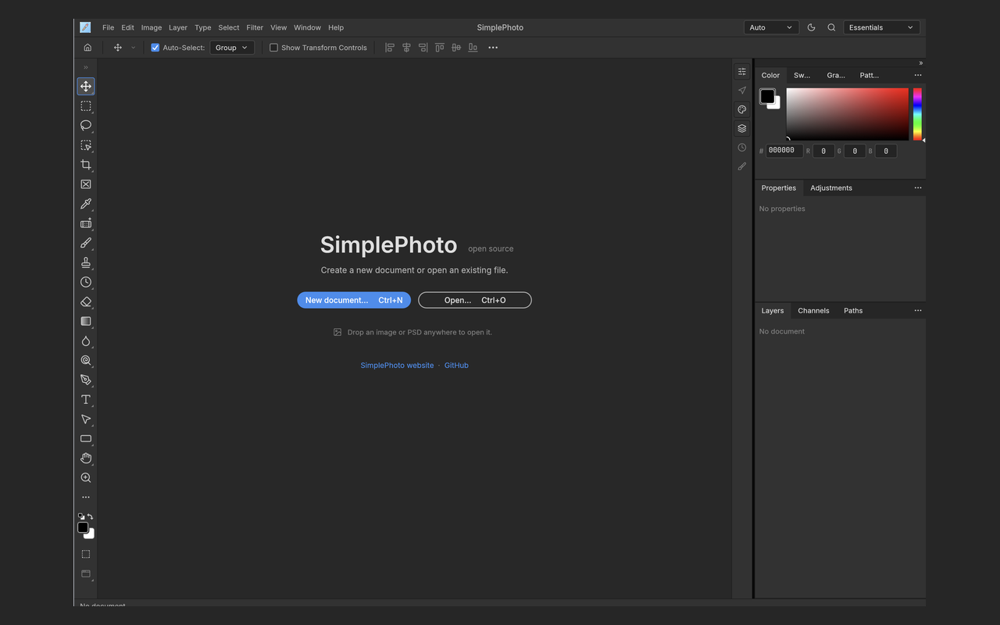
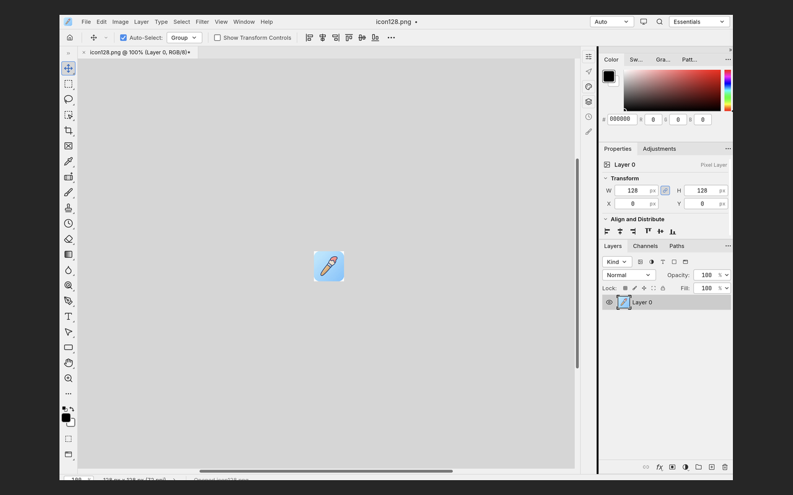
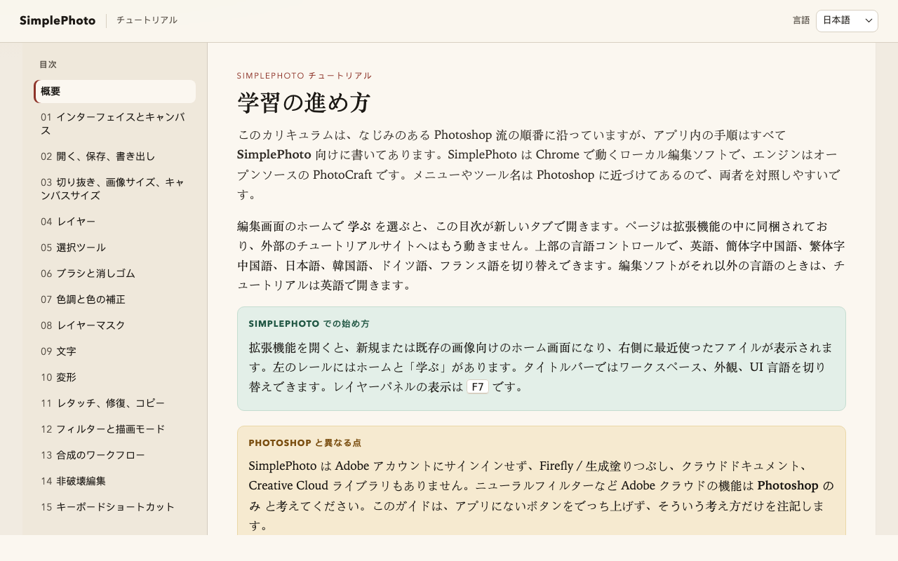

# SimplePhoto

**SimplePhoto** is a Chrome Manifest V3 extension that embeds the [PhotoCraft](https://github.com/storytold/photocraft) WASM web editor as a full-page local image editor. Open images in the browser, edit them with PhotoCraft’s tools, and save/export via the browser’s download flow—no cloud upload required for core editing.

> 中文说明见 [`README_ZH.md`](README_ZH.md).

This repository is a **wrapper / product shell** around PhotoCraft. It does **not** claim ownership of PhotoCraft. Upstream PhotoCraft remains copyright its authors and contributors ([storytold/photocraft](https://github.com/storytold/photocraft)), typically under MIT / Apache-2.0. SimplePhoto adds the Chrome extension packaging, branding chrome, patches workflow, and build scripts described below.

The current extension version is **0.1.7** (`extension/manifest.json`).

## Screenshots

Chrome Web Store–ready **1280×800** PNGs (letterboxed on `#262626`) live under [`docs/store/`](docs/store/). Upload these when submitting the extension:

| Preview | File |
|---------|------|
| Start / splash screen | [`docs/store/screenshot-01-splash-1280x800.png`](docs/store/screenshot-01-splash-1280x800.png) |
| Editing paintbrush `icon128` | [`docs/store/screenshot-02-editor-1280x800.png`](docs/store/screenshot-02-editor-1280x800.png) |
| Bundled tutorials (Japanese index) | [`docs/tutorials-preview.png`](docs/tutorials-preview.png) |







## Features

- **Local WASM editor** — PhotoCraft runs in an extension page (`extension/editor/`) with MV3 CSP (`wasm-unsafe-eval`).
- **Language selector** — top-bar control wired to PhotoCraft’s existing `interface.language` / i18n (including Simplified Chinese).
- **Bundled tutorials** — Home › Learn opens a curriculum inside the extension. It ships in English, Simplified Chinese, Traditional Chinese, Japanese, Korean, German, and French (`en`, `zh-hans`, `zh-hant`, `ja`, `ko`, `de`, `fr`). Learn passes the editor language as `?lang=`; any other editor language falls back to English. The in-page switcher lists only those seven languages.
- **Open / Save** — open images from the browser; save/export uses web download semantics.
- **SimplePhoto branding** — paintbrush app mark under [`branding/`](branding/), Chrome toolbar icons under [`extension/icons/`](extension/icons/), Help/About/splash copy via patches. Icon corners outside the rounded square are transparent (alpha 0).

## Quick start (Load unpacked)

Prerequisites: Git, Rust toolchain, [`trunk`](https://trunkrs.dev/) on `PATH`.

```bash
git clone https://github.com/SimpleAI2026/SimplePhoto.git
cd SimplePhoto

./scripts/bootstrap-submodule.sh
./scripts/apply-patches.sh          # no-op success when patches/ is empty
./scripts/apply-branding-assets.sh  # install SimplePhoto title-bar PNG into photocraft tree
./scripts/build-web-assets.sh       # trunk release build → extension/editor/
./scripts/check-extension-size.sh   # optional size sanity check
```

Then in Chrome:

1. Open `chrome://extensions`
2. Enable **Developer mode**
3. **Load unpacked** → select this repo’s `extension/` directory
4. Click the toolbar icon to open the editor → Open an image → Export/Save to download

### Packaging

Output goes under gitignored `dist/` as `dist/simplephoto-extension-<version>.zip`.

```bash
./scripts/package-extension.sh            # full package: rebuilds WASM, then zips extension/
./scripts/package-extension.sh --skip-build   # zip only, when extension/editor/ is already built
```

Use a full package after changing the photocraft pin, patches, or the title-bar icon. `--skip-build` is enough for tutorial, manifest, or toolbar-icon-only changes.

Tutorial chapter sources live in `tutorials/src/<lang>/`. After editing them, regenerate the shipped pages:

```bash
./scripts/build-tutorials.py
```

## Branding assets

Canonical paintbrush logo (user-provided PNG):

| Path | Role |
|------|------|
| `branding/simplephoto-logo-source.png` | Canonical source |
| `branding/simplephoto-logo-1024.png` | 1024×1024 master |
| `branding/simplephoto-app-128.png` | 128×128 app / title-bar mark |
| `extension/icons/icon16.png` / `icon32.png` / `icon48.png` / `icon128.png` | Chrome extension toolbar & store icons |

These PNGs are rounded squares whose corner pixels are masked to transparent (alpha 0). `./scripts/apply-branding-assets.sh` copies `branding/simplephoto-app-128.png` into the PhotoCraft submodule asset path used by `include_bytes!` for the in-app title-bar icon. **A full `./scripts/build-web-assets.sh` is required** after changing that PNG so the baked WASM picks up the new mark. Extension chrome icons update as soon as you reload the unpacked extension.

## Development notes

- Implementation plan: start at [`plan/README.md`](plan/README.md). Milestone for i18n/branding: [`plan/08-i18n-branding-logo.md`](plan/08-i18n-branding-logo.md).
- PhotoCraft is a Git submodule pinned at `thirdparty/photocraft` (SHA `e052eabf4be74612725400955d184f85d208c0f0`).
- Permanent upstream edits live only in `patches/*.patch`. Apply with `./scripts/apply-patches.sh` from the pinned baseline; do not treat a dirty submodule as source of truth. Patch policy: [`plan/patches.md`](plan/patches.md).
- Platform / bridge notes: `extension/PLATFORM.md`.
- Built editor assets under `extension/editor/` are **gitignored** and regenerated by `build-web-assets.sh`.
- Bundled tutorials (Home › Learn): [`extension/tutorials/`](extension/tutorials/index.html). Chapter sources: `tutorials/src/<lang>/`. Build: [`scripts/build-tutorials.py`](scripts/build-tutorials.py). Overview: [`tutorials/README.md`](tutorials/README.md). Preview: [`docs/tutorials-preview.png`](docs/tutorials-preview.png).

## Acknowledgments

Huge thanks to the **PhotoCraft** project and the **storytold** authors/contributors for the open-source WASM image editor that SimplePhoto embeds. See [github.com/storytold/photocraft](https://github.com/storytold/photocraft).

## License, copyright, and trademarks

- **PhotoCraft** (code under `thirdparty/photocraft/` and its upstream): copyright its authors; licensed under the terms shipped with that project (MIT and/or Apache-2.0). SimplePhoto does not relicense or claim ownership of PhotoCraft.
- **SimplePhoto** wrapper (Chrome extension shell, scripts, patches, and SimplePhoto-specific branding assets in this repository): separate product packaging around PhotoCraft. Prefer the same open-source spirit for contributions unless a file states otherwise.
- **Trademarks**: PhotoCraft, storytold, Chrome, and other names are trademarks of their respective owners. Use of those names here is for attribution and interoperability only.
- **Copyright concerns**: if you believe material in this repository infringes your rights, please open a GitHub issue at [SimpleAI2026/SimplePhoto Issues](https://github.com/SimpleAI2026/SimplePhoto/issues) with details so maintainers can respond.

## Links

- English README (this file): [`README.md`](README.md)
- 简体中文: [`README_ZH.md`](README_ZH.md)
- Plans: [`plan/`](plan/)
- Upstream: [storytold/photocraft](https://github.com/storytold/photocraft)
- Issues: [github.com/SimpleAI2026/SimplePhoto/issues](https://github.com/SimpleAI2026/SimplePhoto/issues)
