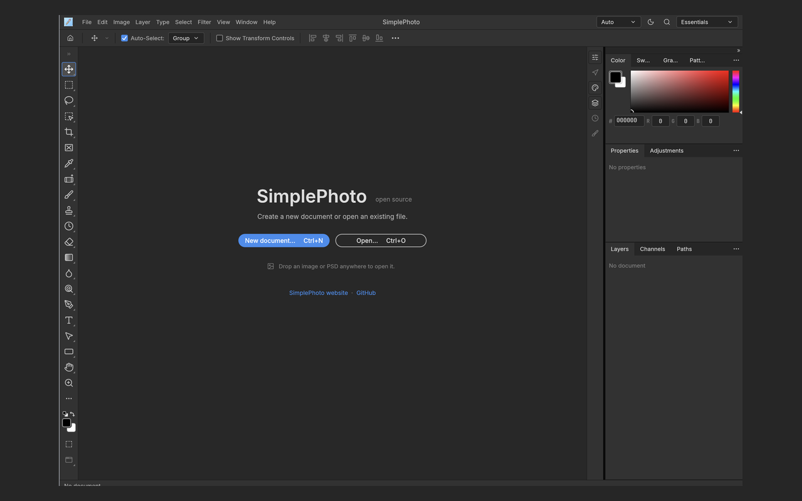
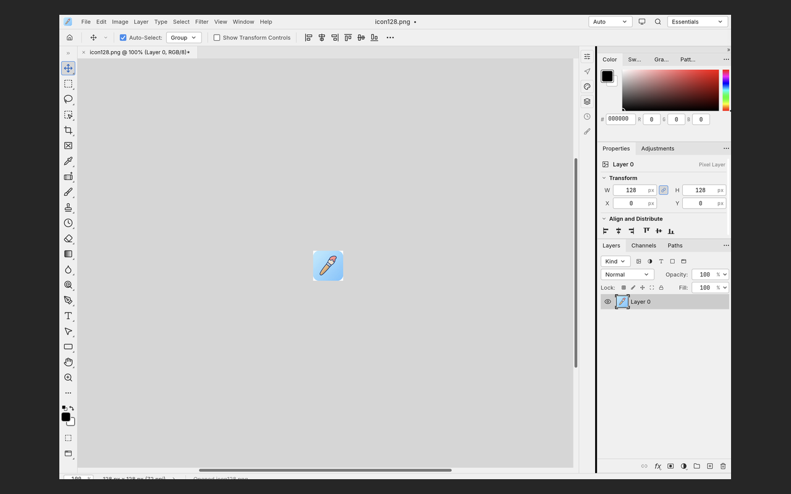
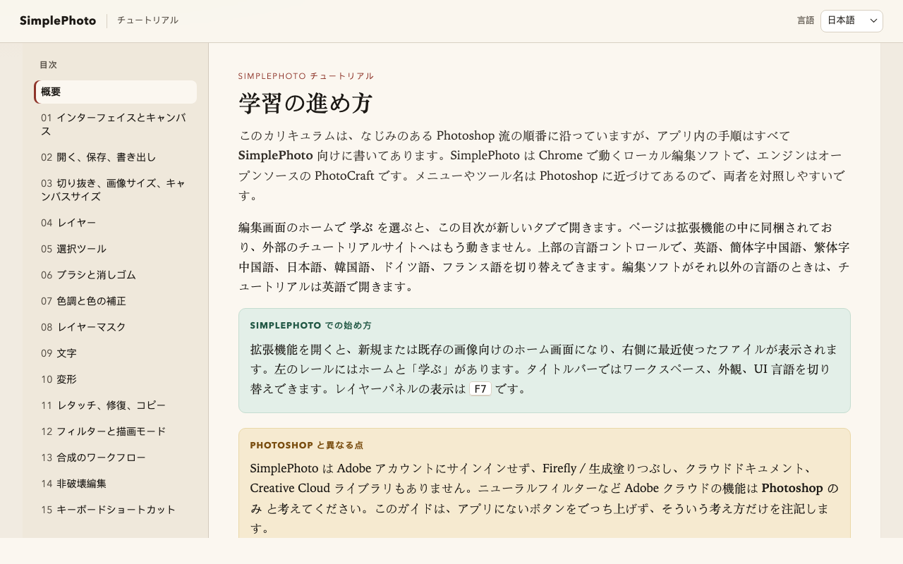

# SimplePhoto

**SimplePhoto** 是一个 Chrome Manifest V3 扩展：把 [PhotoCraft](https://github.com/storytold/photocraft) 的 WASM Web 编辑器嵌进扩展全页，用于**本地**图片编辑。在浏览器中打开图片、用 PhotoCraft 工具编辑，并通过浏览器下载语义保存/导出——核心编辑无需上传云端。

> English: see [`README.md`](README.md).

本仓库是 PhotoCraft 的**包装层 / 产品壳**，**不主张**拥有 PhotoCraft。上游 PhotoCraft 仍归其作者与贡献者所有（[storytold/photocraft](https://github.com/storytold/photocraft)），通常采用 MIT / Apache-2.0。SimplePhoto 提供 Chrome 扩展打包、品牌壳、patch 工作流与构建脚本（见下文）。

当前扩展版本为 **0.1.7**（`extension/manifest.json`）。

## 截图

Chrome 网上应用店可用的 **1280×800** PNG（深色背景 `#262626` 留白居中）放在 [`docs/store/`](docs/store/)。提交扩展时请上传这些文件：

| 预览 | 文件 |
|------|------|
| 启动 / 欢迎页 | [`docs/store/screenshot-01-splash-1280x800.png`](docs/store/screenshot-01-splash-1280x800.png) |
| 编辑画笔 `icon128` | [`docs/store/screenshot-02-editor-1280x800.png`](docs/store/screenshot-02-editor-1280x800.png) |
| 内置教程（日语目录页） | [`docs/tutorials-preview.png`](docs/tutorials-preview.png) |







## 功能

- **本地 WASM 编辑器** — PhotoCraft 运行在扩展页（`extension/editor/`），遵循 MV3 CSP（`wasm-unsafe-eval`）。
- **语言选择** — 顶栏控件接入 PhotoCraft 现有的 `interface.language` / i18n（含简体中文）。
- **内置教程** — 主页「学习」会在扩展内打开教程。现提供英语、简体中文、繁体中文、日语、韩语、德语、法语（`en`、`zh-hans`、`zh-hant`、`ja`、`ko`、`de`、`fr`）。「学习」会通过 `?lang=` 传入编辑器语言；若该语言没有教程，则回退到英语。教程页内的语言菜单只列出这七种语言。
- **打开 / 保存** — 从浏览器打开图片；保存/导出走 Web 下载语义。
- **SimplePhoto 品牌** — 画笔 Logo 见 [`branding/`](branding/)，工具栏图标见 [`extension/icons/`](extension/icons/)，Help/About/启动页文案经 patches 调整。圆角方形图标在圆角外的角落为透明（alpha 为 0）。

## 快速开始（加载已解压的扩展）

前置：Git、Rust 工具链、[`trunk`](https://trunkrs.dev/) 在 `PATH` 中。

```bash
git clone https://github.com/SimpleAI2026/SimplePhoto.git
cd SimplePhoto

./scripts/bootstrap-submodule.sh
./scripts/apply-patches.sh          # patches/ 为空时 no-op 成功
./scripts/apply-branding-assets.sh  # 把 SimplePhoto 顶栏 PNG 装入 photocraft 树
./scripts/build-web-assets.sh       # trunk release → extension/editor/
./scripts/check-extension-size.sh   # 可选体积检查
```

然后在 Chrome 中：

1. 打开 `chrome://extensions`
2. 打开**开发者模式**
3. **加载已解压的扩展程序** → 选择本仓库的 `extension/` 目录
4. 点击工具栏图标打开编辑器 → Open 图片 → Export/Save 下载

### 打包

产物写到 gitignore 的 `dist/`，文件名为 `dist/simplephoto-extension-<version>.zip`。

```bash
./scripts/package-extension.sh            # 完整打包：重建 WASM，再打包 extension/
./scripts/package-extension.sh --skip-build   # 仅打包，适用于 extension/editor/ 已经构建好的情况
```

更换 photocraft 钉住版本、patches 或顶栏图标后需要完整打包。仅改教程、manifest 或工具栏图标时，使用 `--skip-build` 即可。

教程章节源文件在 `tutorials/src/<lang>/`。修改后重新生成扩展内页面：

```bash
./scripts/build-tutorials.py
```

## 品牌资源

画笔 Logo（用户提供的 PNG）为规范源：

| 路径 | 作用 |
|------|------|
| `branding/simplephoto-logo-source.png` | 规范源图 |
| `branding/simplephoto-logo-1024.png` | 1024×1024 母版 |
| `branding/simplephoto-app-128.png` | 128×128 应用 / 顶栏图标 |
| `extension/icons/icon16.png` / `icon32.png` / `icon48.png` / `icon128.png` | Chrome 扩展工具栏与商店图标 |

这些 PNG 是圆角方形，圆角外的角落像素被遮罩为透明（alpha 为 0）。`./scripts/apply-branding-assets.sh` 会把 `branding/simplephoto-app-128.png` 复制到 PhotoCraft submodule 中供 `include_bytes!` 使用的资源路径。更换该 PNG 后**必须**再跑完整的 `./scripts/build-web-assets.sh`，WASM 内烘焙的顶栏图标才会更新。扩展工具栏图标在重新「加载已解压的扩展」后即可生效。

## 开发说明

- 实现计划从 [`plan/README.md`](plan/README.md) 开始；i18n/品牌里程碑见 [`plan/08-i18n-branding-logo.md`](plan/08-i18n-branding-logo.md)。
- PhotoCraft 以 Git submodule 钉在 `thirdparty/photocraft`（SHA `e052eabf4be74612725400955d184f85d208c0f0`）。
- 对上游的永久改动只进 `patches/*.patch`。用 `./scripts/apply-patches.sh` 从钉住基线应用；不要把脏 submodule 当真相源。策略见 [`plan/patches.md`](plan/patches.md)。
- 平台 / 桥接说明：`extension/PLATFORM.md`。
- `extension/editor/` 下构建产物被 **gitignore**，由 `build-web-assets.sh` 重新生成。
- 内置教程（主页「学习」）：[`extension/tutorials/`](extension/tutorials/index.html)。章节源文件：`tutorials/src/<lang>/`。构建脚本：[`scripts/build-tutorials.py`](scripts/build-tutorials.py)。说明见 [`tutorials/README.md`](tutorials/README.md)。预览图：[`docs/tutorials-preview.png`](docs/tutorials-preview.png)。

## 致谢

感谢 **PhotoCraft** 项目与 **storytold** 作者/贡献者提供开源 WASM 图像编辑器，SimplePhoto 在此基础上做扩展嵌入。详见 [github.com/storytold/photocraft](https://github.com/storytold/photocraft)。

## 许可、版权与商标

- **PhotoCraft**（`thirdparty/photocraft/` 及其上游）：版权归其作者；遵循该项目自带许可（MIT 和/或 Apache-2.0）。SimplePhoto 不重新许可，也不主张拥有 PhotoCraft。
- **SimplePhoto** 包装层（本仓库中的 Chrome 扩展壳、脚本、patches 与 SimplePhoto 专用品牌资源）：围绕 PhotoCraft 的独立产品打包。除非单文件另有说明，贡献默认延续开源协作方式。
- **商标**：PhotoCraft、storytold、Chrome 等名称分属各自权利人。此处仅为署名与互操作说明而使用。
- **版权疑虑**：若认为本仓库内容侵犯你的权利，请在 [SimpleAI2026/SimplePhoto Issues](https://github.com/SimpleAI2026/SimplePhoto/issues) 开 issue 并说明详情，以便维护者处理。

## 链接

- 英文：[`README.md`](README.md)
- 简体中文（本文件）：[`README_ZH.md`](README_ZH.md)
- 计划：[`plan/`](plan/)
- 上游：[storytold/photocraft](https://github.com/storytold/photocraft)
- Issues：[github.com/SimpleAI2026/SimplePhoto/issues](https://github.com/SimpleAI2026/SimplePhoto/issues)
